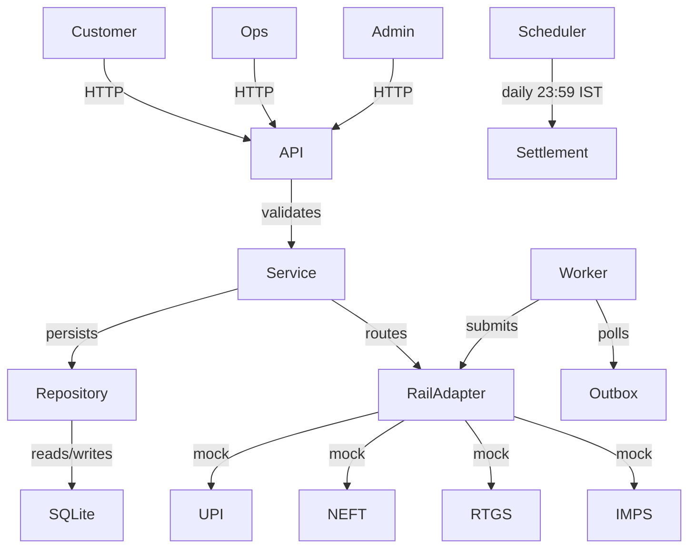
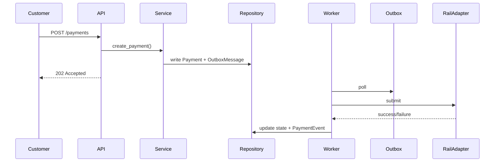

# PayBridge Architecture

## System Overview

## Payment Flow

## Layered Structure
backend/src/paybridge/
├── types/ # Enums, models, errors, ports
├── config/ # Constants, rail settings
├── lib/ # Time, IDs, clock helpers
├── repository/ # Database access only
├── service/ # Business logic only
└── api/ # FastAPI routes only

frontend/src/
├── api/ # HTTP client
├── components/ # Reusable UI
└── pages/ # Screen components

## Key Design Decisions
- **Option B**: State machine with persisted outbox and background worker
- **SQLite WAL mode**: Single writer, sufficient for demo scale
- **Integer paise**: Never floating point, conversion only at API boundary
- **Append-only**: PaymentEvent, settlement files, migrations never mutate
- **Idempotency**: Unique constraint on (customer_id, idempotency_key) with 24h expiry
