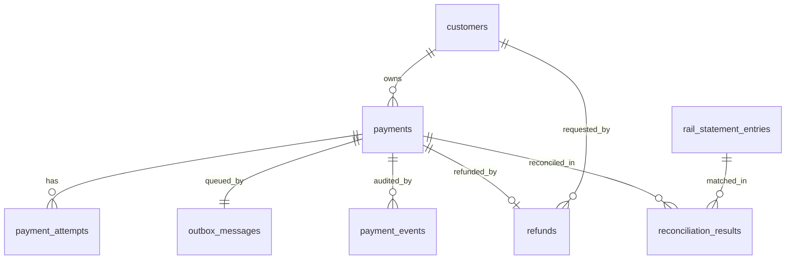

# PayBridge Data Models

SQLite file, WAL mode. Nine tables. Money is `INTEGER` paise (never REAL). Timestamps are `TEXT` UTC ISO 8601 with `Z` (`2026-10-04T09:30:00Z`). Dates are `TEXT` `YYYY-MM-DD` (IST calendar day). Booleans are `INTEGER 0/1`. Machine-readable shapes: `data-models.schema.json` (draft-07). Additions beyond the BRD entity table are marked (X#) and listed in `system-design.md` "Design extensions".

Pragmas per connection: `journal_mode=WAL`, `synchronous=NORMAL`, `foreign_keys=ON`, `busy_timeout=10000`.

## Entity relationships



## 1. customers

Demo users for all three roles (the table backs role validation and the picker).

| Column | Type | Constraints |
|---|---|---|
| id | TEXT | PRIMARY KEY (`cus_001`, `ops_001`, `adm_001`) |
| name | TEXT | NOT NULL, length >= 1 |
| role | TEXT | NOT NULL, CHECK in ('customer','ops','admin') |
| created_at | TEXT | NOT NULL |

Example: `{"id":"cus_001","name":"Asha Verma","role":"customer","created_at":"2026-10-01T00:00:00Z"}`. Seed: 3 customers, `ops_001` (Ops Analyst), `adm_001` (Admin), idempotent via `INSERT OR IGNORE`.

## 2. payments

| Column | Type | Constraints |
|---|---|---|
| id | TEXT | PRIMARY KEY (`pay_` + 12 hex) |
| customer_id | TEXT | NOT NULL, FK customers(id) |
| idempotency_key | TEXT | NOT NULL, CHECK length 1..128 |
| request_hash | TEXT | NOT NULL, sha256 hex of canonical `{amount_paise, beneficiary}` (X1) |
| amount_paise | INTEGER | NOT NULL, **CHECK (amount_paise >= 100)** |
| rail | TEXT | NOT NULL, CHECK in ('UPI','IMPS','NEFT','RTGS') |
| beneficiary | TEXT | NOT NULL, CHECK length 1..140 (never logged unmasked) |
| state | TEXT | NOT NULL, CHECK in ('CREATED','SUBMITTED','COMPLETED','FAILED') |
| reason_code | TEXT | NULL; required when FAILED |
| rail_reference | TEXT | NULL; required when COMPLETED (X1) |
| submitted_at | TEXT | NULL; set at CREATED->SUBMITTED (X1) |
| completed_at | TEXT | NULL; set at COMPLETED, equals rail `accepted_at` (X1, X3) |
| stuck_flagged_at | TEXT | NULL; set once by stuck detection (X1, X9) |
| **idempotency_released_at** | TEXT | NULL. Non-NULL once the key slot was released after the 24 h TTL (decision 7) |
| created_at | TEXT | NOT NULL |
| updated_at | TEXT | NOT NULL |

Table CHECKs: `(state <> 'COMPLETED' OR (rail_reference IS NOT NULL AND completed_at IS NOT NULL))`, `(state <> 'FAILED' OR reason_code IS NOT NULL)`.

Indexes:

```sql
-- Idempotency: partial unique index. A released row keeps its key for audit
-- but no longer occupies the (customer_id, key) slot.
CREATE UNIQUE INDEX ux_payments_customer_key
  ON payments(customer_id, idempotency_key)
  WHERE idempotency_released_at IS NULL;
CREATE INDEX ix_payments_customer_created ON payments(customer_id, created_at DESC, id DESC);
CREATE INDEX ix_payments_created ON payments(created_at DESC, id DESC);
CREATE INDEX ix_payments_state_submitted ON payments(state, submitted_at);
CREATE INDEX ix_payments_completed_at ON payments(completed_at) WHERE state = 'COMPLETED';
```

Release rule (lazy, inside the create transaction under `BEGIN IMMEDIATE`): if the active row (`idempotency_released_at IS NULL`) for `(customer_id, key)` has `created_at + 86400 s <= now`, run `UPDATE payments SET idempotency_released_at=:now WHERE id=:id AND idempotency_released_at IS NULL` then insert the new payment. Within the window: same hash replays (200), different hash is 409. The window is fixed from the original `created_at`. No other column of the released payment changes.

State transitions allowed by the repository/service: CREATED->SUBMITTED, SUBMITTED->COMPLETED, SUBMITTED->FAILED. (COMPLETED->SUBMITTED and FAILED->COMPLETED are rejected, F004.)

Example (completed IMPS payment):

```json
{"id":"pay_3f9a1c07b2de","customer_id":"cus_001","idempotency_key":"7b1f2c3e-9d4a-4e55-8a10-6c2d9e0f1a22",
 "request_hash":"e3b0c44298fc1c149afbf4c8996fb92427ae41e4649b934ca495991b7852b855","amount_paise":10000050,
 "rail":"IMPS","beneficiary":"Ravi Kumar","state":"COMPLETED","reason_code":null,"rail_reference":"IMPS9A3C1F0B27D4",
 "submitted_at":"2026-10-04T09:30:01Z","completed_at":"2026-10-04T09:30:02Z","stuck_flagged_at":null,
 "idempotency_released_at":null,"created_at":"2026-10-04T09:30:00Z","updated_at":"2026-10-04T09:30:02Z"}
```

## 3. payment_attempts

| Column | Type | Constraints |
|---|---|---|
| id | INTEGER | PRIMARY KEY AUTOINCREMENT |
| payment_id | TEXT | NOT NULL, FK payments(id) |
| attempt_no | INTEGER | NOT NULL, CHECK 1..5 |
| outcome | TEXT | NOT NULL, CHECK in ('success','transient','permanent') |
| error_code | TEXT | NULL (reason code for permanent) |
| at | TEXT | NOT NULL |

`UNIQUE(payment_id, attempt_no)`. Example: `{"id":7,"payment_id":"pay_3f9a1c07b2de","attempt_no":3,"outcome":"success","error_code":null,"at":"2026-10-04T09:30:05Z"}`.

## 4. outbox_messages

| Column | Type | Constraints |
|---|---|---|
| id | INTEGER | PRIMARY KEY AUTOINCREMENT |
| payment_id | TEXT | NOT NULL, UNIQUE, FK payments(id) (X8) |
| status | TEXT | NOT NULL, CHECK in ('PENDING','IN_PROGRESS','SENT') |
| next_attempt_at | TEXT | NOT NULL |
| attempts | INTEGER | NOT NULL DEFAULT 0, CHECK 0..5 |
| claimed_at | TEXT | NULL (X8) |
| created_at | TEXT | NOT NULL |
| updated_at | TEXT | NOT NULL |

Index: `ix_outbox_due ON outbox_messages(status, next_attempt_at)`. Example: `{"id":12,"payment_id":"pay_3f9a1c07b2de","status":"PENDING","next_attempt_at":"2026-10-04T09:30:03Z","attempts":2,"claimed_at":null,"created_at":"2026-10-04T09:30:00Z","updated_at":"2026-10-04T09:30:01Z"}`.

## 5. payment_events (append-only)

| Column | Type | Constraints |
|---|---|---|
| id | TEXT | PRIMARY KEY (`evt_` + 12 hex) |
| payment_id | TEXT | NOT NULL, FK payments(id) |
| type | TEXT | NOT NULL, CHECK in the 11 event types (conventions) |
| payload | TEXT | NOT NULL DEFAULT '{}', CHECK json_valid(payload); never contains the beneficiary |
| at | TEXT | NOT NULL |

Chronological order is insertion `rowid` (X18). Index `ix_events_payment ON payment_events(payment_id)`.

```sql
CREATE TRIGGER trg_payment_events_no_update BEFORE UPDATE ON payment_events
BEGIN SELECT RAISE(ABORT, 'payment_events is append-only'); END;
CREATE TRIGGER trg_payment_events_no_delete BEFORE DELETE ON payment_events
BEGIN SELECT RAISE(ABORT, 'payment_events is append-only'); END;
```

The repository exposes only `append` and `list_for_payment`. Example: `{"id":"evt_5d2a9b1c0e3f","payment_id":"pay_3f9a1c07b2de","type":"PAYMENT_RETRY_SCHEDULED","payload":{"attempt_no":1,"delay_seconds":1,"next_attempt_at":"2026-10-04T09:30:02Z"},"at":"2026-10-04T09:30:01Z"}`.

## 6. refunds

| Column | Type | Constraints |
|---|---|---|
| id | TEXT | PRIMARY KEY (`rfd_` + 12 hex) |
| payment_id | TEXT | NOT NULL, **UNIQUE**, FK payments(id) |
| amount_paise | INTEGER | NOT NULL, CHECK >= 100 (equals payment amount, full refund only) |
| state | TEXT | NOT NULL, CHECK in ('REQUESTED','APPROVED','EXECUTED','REJECTED','FAILED') |
| requested_by | TEXT | NOT NULL, FK customers(id) |
| decided_by | TEXT | NULL, FK customers(id) |
| reason_code | TEXT | NULL (`REJECTED_BY_ADMIN` or the permanent reversal code, X6) |
| created_at | TEXT | NOT NULL |
| updated_at | TEXT | NOT NULL |

Index `ix_refunds_state ON refunds(state)`. Example: `{"id":"rfd_8c1d2e4f5a6b","payment_id":"pay_3f9a1c07b2de","amount_paise":10000050,"state":"EXECUTED","requested_by":"cus_001","decided_by":"adm_001","reason_code":null,"created_at":"2026-10-04T10:00:00Z","updated_at":"2026-10-04T10:05:00Z"}`.

## 7. rail_statement_entries

| Column | Type | Constraints |
|---|---|---|
| id | TEXT | PRIMARY KEY (`rse_` + 12 hex, X4) |
| rail | TEXT | NOT NULL, CHECK rails |
| payment_ref | TEXT | NOT NULL (the rail reference) |
| payment_id | TEXT | NULL, no FK (rail echo of our payment id; may be unknown) (X4) |
| amount_paise | INTEGER | NOT NULL, CHECK >= 0 (external data may be anomalous) (X4) |
| status | TEXT | NULL or a ReconStatus value (set by matching) |
| statement_date | TEXT | NOT NULL (IST date of the ledger `accepted_at`) |
| created_at | TEXT | NOT NULL |

`UNIQUE(rail, payment_ref, statement_date)`; index on `statement_date`. Example: `{"id":"rse_1a2b3c4d5e6f","rail":"IMPS","payment_ref":"IMPS9A3C1F0B27D4","payment_id":"pay_3f9a1c07b2de","amount_paise":10000050,"status":"matched","statement_date":"2026-10-04","created_at":"2026-10-04T18:40:00Z"}`.

## 8. reconciliation_results

| Column | Type | Constraints |
|---|---|---|
| id | TEXT | PRIMARY KEY (`rec_` + 12 hex) |
| statement_date | TEXT | NOT NULL |
| rail | TEXT | NOT NULL |
| status | TEXT | NOT NULL, CHECK in the 4 ReconStatus values |
| payment_id | TEXT | NULL, FK payments(id) |
| statement_entry_id | TEXT | NULL, FK rail_statement_entries(id) |
| payment_ref | TEXT | NULL |
| payment_amount_paise | INTEGER | NULL |
| statement_amount_paise | INTEGER | NULL |
| resolved | INTEGER | NOT NULL DEFAULT 0, CHECK in (0,1) |
| resolution_note | TEXT | NULL; NOT NULL when resolved = 1 |
| resolved_by | TEXT | NULL, FK customers(id) |
| resolved_at | TEXT | NULL |
| created_at, updated_at | TEXT | NOT NULL |

CHECK `(payment_id IS NOT NULL OR statement_entry_id IS NOT NULL)`. Unique expression index for idempotent re-runs: `CREATE UNIQUE INDEX ux_recon_key ON reconciliation_results(statement_date, rail, COALESCE(payment_id,''), COALESCE(statement_entry_id,''))`. Index `ix_recon_queue ON reconciliation_results(resolved, status)`. Example: `{"id":"rec_77aa88bb99cc","statement_date":"2026-10-04","rail":"UPI","status":"amount_mismatch","payment_id":"pay_...","statement_entry_id":"rse_...","payment_ref":"UPI...","payment_amount_paise":150000,"statement_amount_paise":149999,"resolved":0,"resolution_note":null,"resolved_by":null,"resolved_at":null,...}`.

## 9. settlement_files

| Column | Type | Constraints |
|---|---|---|
| id | TEXT | PRIMARY KEY (`stl_` + 12 hex) |
| business_date | TEXT | NOT NULL (IST date) |
| kind | TEXT | NOT NULL, CHECK in ('primary','followup') |
| sequence | INTEGER | NOT NULL; 0 for primary, 1.. for follow-ups (X5) |
| path | TEXT | NOT NULL, UNIQUE (relative to `SETTLEMENT_DIR`) |
| row_count | INTEGER | NOT NULL, >= 0 |
| checksum | TEXT | NOT NULL, SHA-256 hex over data rows |
| written_at | TEXT | NOT NULL |

CHECK `((kind = 'primary') = (sequence = 0))`; `UNIQUE(business_date, sequence)` (so at most one primary per date). Triggers `BEFORE UPDATE` and `BEFORE DELETE` abort with `settlement_files is append-only`. Example: `{"id":"stl_4e5f6a7b8c9d","business_date":"2026-10-04","kind":"primary","sequence":0,"path":"2026-10-04-primary.csv","row_count":42,"checksum":"9f86d081884c7d659a2feaa0c55ad015a3bf4f1b2b0b822cd15d6c15b0f00a08","written_at":"2026-10-04T18:29:00Z"}`.

## CSV file format (not a table)

```
payment_id,rail,amount_paise,rail_ref,recon_status,unmatched_flag
pay_3f9a1c07b2de,IMPS,10000050,IMPS9A3C1F0B27D4,matched,false
# row_count=1
# sha256=<hex of the data rows only>
```

## Rail ledger (external simulation, not a table)

`RAIL_LEDGER_PATH` JSONL, one object per line: `{"type":"PAYMENT"|"REVERSAL","rail","payment_id","rail_ref","amount_paise","accepted_at"}`. Unique per `(type, rail, payment_id)`; resubmission returns the existing entry.

## Money and ID rules

All `*_paise` columns are INTEGER; Python types are `int`; no float anywhere. IDs are generated in `lib/ids.py` from `uuid4().hex[:12]` with the prefix.
