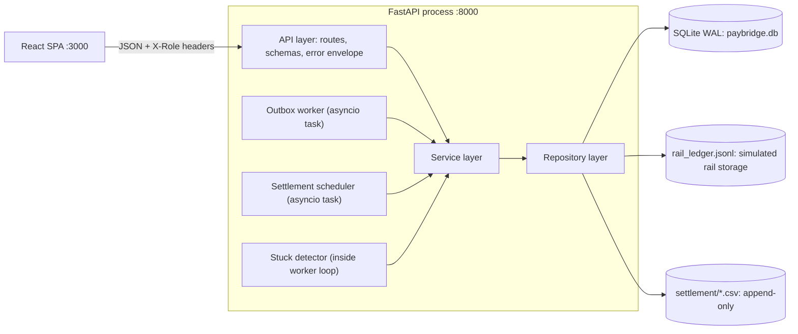

# PayBridge System Design

Binding inputs: `specs/design/conventions.md` (field names, enums, error envelope, endpoints, approved decisions 1-7), `specs/brd/brd.md`, `specs/features.json` (F001-F138), the 31 stories. Where this document adds detail not in conventions.md it is listed under "Design extensions" at the end.

## 1. Context and components

PayBridge is one Python process (FastAPI + asyncio background tasks) with one SQLite file, plus a React SPA. All four rails are in-process mock adapters backed by a file-based "rail ledger" that simulates the rail's own storage.



| Component | Responsibility |
|---|---|
| API layer | Header auth dependencies, role guards, request/response schemas, error envelope mapping, CORS, lifespan wiring (composition root `api/container.py`) |
| PaymentService | Validate, route, idempotency decision, create payment + outbox + event in one transaction; get/list |
| OutboxWorker + DeliveryService | Claim outbox rows, submit to rail adapter, record attempts/events, schedule retries, terminal transitions |
| Rail adapters (UPI, IMPS, NEFT, RTGS) | One `RailAdapter` port; mock behaviour driven by `SimulationService` config; dedupe on payment id through the rail ledger |
| SimulationService | In-memory per-rail mode config (success, permanent_failure+reason, transient+rate), seeded RNG injectable |
| StuckService | Flags SUBMITTED payments older than 300 s once, lists them |
| RefundService | Request, approve (reversal via adapter), reject; one refund per payment |
| StatementService + ReconciliationService + matching | Persist statement entries from rail ledger, match, upsert results, resolve with note |
| SettlementService + CSV builder + Scheduler | Build primary/follow-up files for an IST business date, daily 23:59 IST job |
| DashboardService | Aggregates for one IST date |
| lib (cross-cutting) | Clock implementation, id generation, IST helpers, log masking (record factory) |

## 2. Layering (one-way)

Types (1) -> Config (2) -> Repository (3) -> Service (4) -> API (5) -> UI (6). A layer imports only from layers below it. `lib/` is a cross-cutting package (per `.claude/architecture.md` Cross-Cutting Concerns) that imports nothing from the other layers and may be imported by all.

| Layer | Backend package `paybridge.*` | Contents |
|---|---|---|
| Types | `types` | Enums, domain dataclasses, typed errors, `Clock`/`RailAdapter`/`RailLedger` Protocols, `route_rail`, money helpers, state transition tables |
| Config | `config` | `Settings` from env, constants (TTL, retry, stuck, tz), rail settings, logging setup |
| Repository | `repository` | Connection/transaction manager, DDL, one repository per table, aggregate queries, rail ledger file, settlement file store |
| Service | `service` | All business rules and orchestration, adapters, worker, scheduler |
| API | `api` | FastAPI app, routes, pydantic schemas, auth dependencies, exception handlers |
| UI | `frontend/src/ui` | React pages/components. Frontend layers: `types`, `config`, `service` (pure logic), `api` (HTTP client), `ui` |

Rules enforced: services never import `paybridge.api`; repositories never import services; Types import nothing. Domain errors are typed classes in `types/errors.py` and mapped to the envelope only in `api/errors.py` (never swallowed). Dependencies (clock, rng, rail ledger, settings, connections) are injected via constructors; `api/container.py` is the only composition root.

The architecture hook greps `src/types/`, `src/config/` etc. The backend package path is `backend/src/paybridge/...`; see extension X16 about the manifest layer override and the `src.main:app` shim.

## 3. Key decisions and rationale

| Decision | Rationale |
|---|---|
| Persisted outbox + in-process worker (BRD option B) | API stays fast (NFR-01), crash-safe, retry/idempotency testable |
| SQLite WAL, one writer at a time, short transactions | Meets NFR-02 on a laptop; no external DB |
| Synchronous `sqlite3` repositories; FastAPI `def` handlers run in the threadpool; worker uses `asyncio.to_thread` | No async driver needed; keeps functions simple and testable |
| Money INTEGER paise, `amount_paise` int at the API | NFR-04; rupee strings exist only in UI (`service/money.ts`) |
| Injected `Clock` everywhere (no `datetime.now()` in services) | Deterministic tests for 24 h TTL, backoff, stuck, IST cutoffs |
| Deterministic rail reference `f"{RAIL}{sha256(payment_id)[:12].upper()}"` plus rail ledger dedupe | Resubmission after a crash always yields the same reference (F035, F062) even if the ledger write was lost |
| Rail ledger as an append-only JSONL file outside the DB | It models an external system, so it survives process restarts, keeps the 9-table schema, and lets reconciliation see "rail-side" data including injected anomalies |
| payment_events append-only via triggers + no update/delete repository methods | NFR-05 audit trail |
| Partial unique index for idempotency (section 5) | Decision 7 |
| Errors: one envelope, typed domain errors | Conventions |
| Permanent failure does not fall back to another rail | BRD 5.3 |

## 4. Data flows

### 4.1 Payment create -> outbox -> worker -> rail

```mermaid
sequenceDiagram
  participant C as Client
  participant A as API
  participant S as PaymentService
  participant D as SQLite
  participant W as Worker
  participant R as Rail adapter
  C->>A: POST /payments (Idempotency-Key, body)
  A->>S: create(caller, key, amount_paise, beneficiary)
  S->>D: BEGIN IMMEDIATE; idempotency check; INSERT payment CREATED, outbox PENDING, event PAYMENT_CREATED; COMMIT
  A-->>C: 202 Payment (200 + Idempotent-Replay on replay)
  loop every WORKER_POLL_INTERVAL (0.5 s)
    W->>D: BEGIN IMMEDIATE; select PENDING with next_attempt_at <= now (limit 10); set IN_PROGRESS, claimed_at; COMMIT
    W->>D: txn1: payment CREATED->SUBMITTED, submitted_at, event PAYMENT_SUBMITTED (skipped if already SUBMITTED)
    W->>R: submit(payment_id, amount_paise)  [outside any DB transaction]
    R-->>W: success(rail_ref, accepted_at) | TransientRailError | PermanentRailError
    W->>D: txn2: attempt row + payment/outbox/event updates (4.2)
  end
```

Create transaction order: (1) validate (outside txn): amount >= 100 else `AMOUNT_BELOW_MINIMUM`, beneficiary stripped 1..140, key 1..128; (2) `route_rail`; (3) `BEGIN IMMEDIATE`; idempotency decision (section 5); insert payment, outbox (`status=PENDING`, `next_attempt_at=now`, `attempts=0`), event `PAYMENT_CREATED` with payload `{rail, amount_paise}`; commit. Any failure rolls the whole thing back (F021). The beneficiary is never put into event payloads or logs.

### 4.2 Retry/backoff

Attempt outcomes are recorded in `payment_attempts` (`attempt_no` = existing count + 1, unique per payment). The payment stays SUBMITTED across retries.

| Outcome of attempt n | Action (one transaction) |
|---|---|
| success | attempt `success`; payment COMPLETED, `rail_reference`, `completed_at = accepted_at`; event PAYMENT_COMPLETED; outbox SENT |
| transient, n < 5 | attempt `transient`; outbox PENDING, `attempts = n`, `next_attempt_at = now + 2^(n-1) s` (1, 2, 4, 8 s); event PAYMENT_RETRY_SCHEDULED payload `{attempt_no, delay_seconds, next_attempt_at}` |
| transient, n = 5 | attempt `transient`; payment FAILED reason `RETRIES_EXHAUSTED`; event PAYMENT_FAILED; outbox SENT (terminal) |
| permanent | attempt `permanent` with `error_code = reason_code`; payment FAILED with that reason code; event PAYMENT_FAILED; outbox SENT |

Delay constants: `RETRY_MAX_ATTEMPTS = 5`, `RETRY_BASE_DELAY_SECONDS = 1`, delay = base * 2^(n-1).

### 4.3 Crash recovery

The worker is the single consumer (one asyncio task). On startup, before the loop: `UPDATE outbox_messages SET status='PENDING' WHERE status='IN_PROGRESS'` (any IN_PROGRESS row at startup is orphaned). While running, rows IN_PROGRESS longer than `OUTBOX_LEASE_SECONDS = 60` are also reclaimed (guards against a worker iteration that died with its task). Resume is safe because (a) txn1 is skipped when the payment is already SUBMITTED, (b) the adapter dedupes on payment id and returns the same `rail_ref` and the ledger holds exactly one entry, (c) attempt numbers are allocated at txn2. A crash after the rail accepted but before txn2 therefore results in the resumed attempt recording `success` with the same reference. Rows are never processed before `next_attempt_at` (F063). A batch of 10 killed mid-way ends with each payment terminal exactly once (the unique `(payment_id, attempt_no)` and conditional `UPDATE ... WHERE state='SUBMITTED'` prevent double terminal transitions).

### 4.4 Stuck detection

`StuckService.detect(now)`: in one txn, select payments `state='SUBMITTED' AND stuck_flagged_at IS NULL AND submitted_at < now - 300 s` (strictly more than 5 minutes: 5m01s flagged, 4m59s not); set `stuck_flagged_at = now` and append one `PAYMENT_FLAGGED_STUCK` event each (no duplicates because of the NULL guard). Detection runs every `STUCK_SCAN_INTERVAL_SECONDS = 30` inside the worker loop and also at the start of `GET /ops/stuck-payments` (so the endpoint is deterministic). The list is `state='SUBMITTED' AND stuck_flagged_at IS NOT NULL`, so a payment that completes or fails drops out (F068). `age_seconds = now - submitted_at`.

### 4.5 Refunds

- Request (customer): `BEGIN IMMEDIATE`; payment must belong to the caller (else 404); state must be COMPLETED (else 422 `PAYMENT_NOT_REFUNDABLE`); insert refund REQUESTED with `amount_paise` = payment amount, `requested_by` = caller id; unique `payment_id` makes a second request (any prior state) a 409 `REFUND_ALREADY_EXISTS`, including 10 concurrent requests; event `REFUND_REQUESTED` on the payment.
- Approve (admin): txn A: `UPDATE refunds SET state='APPROVED', decided_by=:admin WHERE id=:id AND state='REQUESTED'`; zero rows -> 404 if absent, else 409 `REFUND_ALREADY_DECIDED` (two concurrent approvals: one wins). Event `REFUND_APPROVED`. Then outside a transaction `adapter.reverse(payment_id, amount_paise)` (idempotent in the ledger, honours only success and permanent_failure modes). txn B: success -> `EXECUTED`, event `REFUND_EXECUTED`; `PermanentRailError` -> `FAILED` with the configured reason code, event `REFUND_FAILED`. The payment stays COMPLETED in all cases. A startup sweep re-executes refunds left in APPROVED (crash between A and B).
- Reject (admin): `REQUESTED -> REJECTED`, `decided_by`, `reason_code = REJECTED_BY_ADMIN`, event `REFUND_REJECTED`.

### 4.6 Reconciliation

`POST /reconciliation/run {statement_date}` (ops/admin):
1. `StatementService.generate(date)`: read the rail ledger entries of type PAYMENT whose `accepted_at` falls on that IST date; `INSERT OR IGNORE` into `rail_statement_entries` (unique `(rail, payment_ref, statement_date)`). So a re-run adds no duplicates (F096).
2. `matching.match(payments, entries)` with payments = COMPLETED with `completed_at` on that IST date. Match key is `payment_id`; a result is `matched` only if `payment_id`, `payment_ref == rail_reference` and `amount_paise` all agree. Payment without entry -> `unmatched_internal`; entry not claimed by a payment -> `unmatched_external`; same ids but amounts differ (even by 1 paise) -> `amount_mismatch`; same id but different reference -> one `unmatched_internal` plus one `unmatched_external`.
3. Upsert results keyed by `(statement_date, rail, COALESCE(payment_id,''), COALESCE(statement_entry_id,''))`. On conflict update status only if `resolved = 0`. Entry `status` is set to the result status.
4. Return counts per status. Resolution (`POST /reconciliation/{id}/resolve`) only sets `resolved`, `resolution_note`, `resolved_by`, `resolved_at`; it never touches payments or amounts (F101). Resolving a `matched` row is a 422, resolving twice 409 `RECON_ALREADY_RESOLVED`.

### 4.7 Settlement (IST business date, append-only)

Business date of a payment = IST calendar day of `completed_at` (`lib/timeutil.business_date(ts)`; IST = UTC+5:30, so 18:29:59Z is 23:59:59 IST of day D and 18:30:00Z is 00:00:00 of D+1, F106). Day bounds in UTC are `[D-1 18:30:00Z, D 18:30:00Z)`.

`SettlementService.run(business_date)` (single transaction around DB state, file written atomically):
1. Run reconciliation for the date (so `recon_status` is current).
2. Determine already-settled payment ids: union of rows of all existing files for that date (read from the stored files).
3. If no primary exists: build primary with all COMPLETED payments of that day, kind `primary`, sequence 0 (a primary with zero rows is allowed). If a primary exists: candidates = completed payments absent from every earlier file; none -> no new file, return `file: null` and the "primary exists" message; some -> follow-up file, `sequence = max+1`, kind `followup`.
4. CSV: header `payment_id,rail,amount_paise,rail_ref,recon_status,unmatched_flag`; rows ordered by `(completed_at, payment_id)`, LF newlines; `unmatched_flag = true` unless recon_status is `matched` (unmatched_internal and amount_mismatch are included, never blocking). Footer lines `# row_count=N` and `# sha256=<hex>`. The checksum is SHA-256 over the data rows only (header and footer excluded), each row including its trailing LF.
5. Write to `settlement/<date>-primary.csv` or `<date>-followup-<n>.csv` through a temp file, fsync, then `os.link(tmp, final)` (fails if the target exists, so never overwritten), `chmod 0444`, delete tmp, then insert the `settlement_files` row. If a crash left a final file without a row, the next run adopts it (recomputes checksum, inserts row) rather than overwriting. Repository exposes no update or delete for `settlement_files`; triggers enforce it.
6. HTTP: first primary -> 201; repeat -> 200.

Scheduler: asyncio task computes the next 23:59:00 Asia/Kolkata from the injected clock, sleeps, then runs for that IST date. Once per business day is guaranteed because `run` is idempotent per date (a repeat writes nothing unless late entries exist) and the scheduler records the last date fired. On startup it catches up: if the primary for yesterday (IST) is missing it runs it.

### 4.8 Dashboard

`GET /dashboard/summary?date=` (default today IST): payments created within the IST day (by `created_at`) grouped per rail (`payment_count`, `total_paise` sum of `amount_paise`, all four rails always present) and by state (`status_counts` all four always present); `pending_refunds` = all REQUESTED refunds; `settlement_files` for that `business_date`. No activity returns zeros with 200.

## 5. Idempotency expiry release (decision 7, binding)

Schema: `payments.idempotency_released_at TEXT NULL`; `CREATE UNIQUE INDEX ux_payments_customer_key ON payments(customer_id, idempotency_key) WHERE idempotency_released_at IS NULL`. `request_hash = sha256(canonical_json({"amount_paise": int, "beneficiary": stripped str}))` hex. Config `IDEMPOTENCY_TTL_SECONDS = 86400`.

Algorithm, executed inside the create transaction (`BEGIN IMMEDIATE`):

```
active = SELECT * FROM payments WHERE customer_id=:c AND idempotency_key=:k AND idempotency_released_at IS NULL
if active is None:                     insert new payment
elif active.created_at + TTL > now:    same hash -> replay (200, Idempotent-Replay: true)
                                       different hash -> IdempotencyConflict (409 IDEMPOTENCY_KEY_CONFLICT)
else:                                  UPDATE payments SET idempotency_released_at=:now
                                         WHERE id=:id AND idempotency_released_at IS NULL
                                       insert new payment (hash NOT compared when expired)
```

Properties: window is measured from the original `created_at`, fixed (replays do not extend it); no sweeper; the expired payment is unchanged apart from `idempotency_released_at` (no event added); `BEGIN IMMEDIATE` serialises writers so exactly one request releases and inserts, the others then see the new active row and replay. If an `IntegrityError` on the partial index still surfaces (defensive), the service re-reads the active row inside a fresh transaction and replays or conflicts, never returning 500. Scoped per customer (F027). The clock is injected (F028 uses `FakeClock`). Concurrency argument: `BEGIN IMMEDIATE` takes the single SQLite write lock before the lookup, so the lookup, release and insert are atomic with respect to every other writer; the conditional `UPDATE ... WHERE idempotency_released_at IS NULL` plus the partial unique index guarantee at most one active row per (customer_id, key) even if that serialisation were bypassed. `specs/features.json` is the only feature registry. F028 means: the original payment is unchanged except `idempotency_released_at`.

## 6. SQLite WAL and write-concurrency strategy

- Per connection pragmas: `journal_mode=WAL` (persistent, verified at init: F006), `synchronous=NORMAL`, `foreign_keys=ON`, `busy_timeout=10000` (config `SQLITE_BUSY_TIMEOUT_MS`), `isolation_level=None` (explicit transaction control).
- One connection per unit of work (cheap in SQLite) from `repository/db.py`: `Database.read()` (no transaction, WAL snapshot, never blocks on writers) and `Database.write()` context manager that issues `BEGIN IMMEDIATE`, commits or rolls back. Every write path uses `write()`; deferred transactions that later upgrade to writers are forbidden because an upgrade conflict returns SQLITE_BUSY immediately without honouring busy_timeout.
- Write transactions are short, contain no network/file/rail I/O, and do reads needed for decisions inside the same transaction (idempotency, refund state checks, claim).
- Concurrency tests (F026, F075, F080, F134) use threads with separate connections against a file DB. Load test: threadpool of 40 handlers contend for the single writer lock; busy_timeout absorbs it; target zero SQLITE_BUSY.
- `payment_events` ordering uses insertion `rowid` (timestamps have 1 s resolution).
- Backups: use `sqlite3 .backup` or `VACUUM INTO` (see deployment.md), never copy the file alone while WAL is active.

## 7. Injected Clock

`types/clock.py`: `class Clock(Protocol): def now(self) -> datetime` (timezone-aware UTC). `lib/clock.py`: `SystemClock`. Tests use `FakeClock` (`set`, `advance`). Services accept a `Clock`; repositories receive timestamps as parameters (they never read the time). Timestamps are stored and emitted as `YYYY-MM-DDTHH:MM:SSZ`. The worker's sleep uses an injectable `Sleeper` so tests drive polls without real delay. Backoff `next_attempt_at` is computed from `clock.now()`.

## 8. Log masking approach (NFR-03, E9-S1)

- `lib/masking.py` provides `mask_text(text, sensitive)`, `mask_value(key, value)`, and installs a `logging.setLogRecordFactory` wrapper (`install_masking()`), called from `config/logging_setup.py` at startup and from the test `conftest`. A record factory masks every record at creation, wherever it is logged, including records captured by pytest `caplog`.
- Rules: (1) any digit run of 9-18 digits becomes `*` repeated with the last four digits kept; (2) a beneficiary value becomes per-word first letter + `***` (`Ravi Kumar` -> `R*** K***`); (3) keys named `beneficiary`, `beneficiary_name`, `account_number` in `extra`/dict arguments are masked by key; (4) a bounded, thread-safe registry of "sensitive literals" is populated by `PaymentService` when it handles a beneficiary (`register_sensitive(beneficiary)`), so any free-text occurrence in messages or tracebacks is replaced even with no key name; (5) the factory formats `exc_info` into `exc_text` and masks it, so tracebacks are masked (F131).
- Code convention: beneficiary and request bodies are never logged on purpose; masking is the safety net. Event payloads and `payment_events` never contain the beneficiary. Uvicorn access logs include no bodies.

## 9. NFR mapping

| NFR | Design response | Verified by |
|---|---|---|
| NFR-01 p95 <= 300 ms | Create is one short write txn, no rail I/O, WAL `synchronous=NORMAL` | E9-S2 (F132) |
| NFR-02 >= 20 pay/s | Short txns, BEGIN IMMEDIATE, busy_timeout 10 s, single worker batch 10 | E9-S2 (F133, F134) |
| NFR-03 masking | Section 8 | E9-S1 (F128-F131) |
| NFR-04 integer paise | `amount_paise INTEGER`, CHECK >= 100, API ints, UI-only rupee strings, `Decimal` parse, mypy forbids float `*_paise` | F003, F005, F009, F042 |
| NFR-05 audit | Event per transition, append-only triggers, `requested_by`/`decided_by` | F008, F020, F060 |
| NFR-06 IST | `lib/timeutil` with `zoneinfo("Asia/Kolkata")`, IST dates for statement/business/dashboard dates, scheduler 23:59 IST | F106, F111, F119 |
| NFR-07 WCAG 2.1 AA | Design tokens with 4.5:1 contrast, text badges, labelled controls, focus-trapped dialog, skeletons with aria-busy, role=alert banners | E9-S3 (F135-F138) |
| NFR-08 code standards | ruff, mypy strict, pytest `--cov-fail-under=80`, files < 300 lines, functions < 50 lines (see folder-structure.md) | CI |

## 10. Authentication and authorization

Demo only, not a security control. `api/deps.py`: `get_caller` reads `X-Role` (missing/unknown -> 401 `UNAUTHENTICATED`); customer role requires `X-Customer-Id` matching a `customers` row of role `customer` (else 401). Guards `require_roles(...)` raise 403 `FORBIDDEN`. Guards run as FastAPI dependencies so they fire before body validation (ops POST /payments with an invalid body is 403, not 422). `/health` and `GET /customers` need no headers. Customers see only their own payments and refunds: another customer's payment is 404.

## 11. Error handling

`api/errors.py` registers handlers: domain errors -> envelope with status per conventions; `RequestValidationError` -> 422 `VALIDATION_ERROR` with `fields` (field names without `body.` prefix; header errors use the header name); unknown exceptions -> 500 `INTERNAL_ERROR` with a generic message (details logged, masked). `AmountBelowMinimum` -> 422 `AMOUNT_BELOW_MINIMUM` with `fields:[{field:"amount_paise",...}]`; the UI displays 'Amount must be at least Rs 1'. `Starlette` 404/405 for unknown routes are also mapped to the envelope (`NOT_FOUND`).

## Design extensions

Gaps filled consistently with conventions.md. Implementers treat these as binding.

| # | Extension | Reason |
|---|---|---|
| X1 | `payments` has extra columns `request_hash`, `rail_reference`, `submitted_at`, `completed_at`, `stuck_flagged_at` | Needed for Payment shape, idempotency hash, stuck response, IST business date |
| X2 | Seed ids: `cus_001..cus_003`, `ops_001`, `adm_001` (role column in `customers`); `GET /customers` returns all five | F010, F015 ("all three roles") |
| X3 | Rail ledger is a JSONL file (`RAIL_LEDGER_PATH`); rail reference is deterministic from payment id; `completed_at` is the rail `accepted_at` | Crash dedupe (F062), statement dates without midnight skew |
| X4 | `rail_statement_entries` gains `payment_id` (nullable, no FK) and nullable `status` (ReconStatus); id prefix `rse_`; CHECK `amount_paise >= 0` (external data may be anomalous) | Matching needs payment id and ref; seeded anomalies |
| X5 | `settlement_files` gains `sequence` (0 primary, 1.. follow-ups) and `path`; append-only triggers; checksum covers data rows only; file naming and atomic link-write | BRD data model has `path`; multiple follow-ups; F108/F109 |
| X6 | Reject sets refund `reason_code = REJECTED_BY_ADMIN` (system code, no request body) | F086 requires a reason code for REJECTED refunds, no input exists |
| X7 | Reversal ignores `transient` mode (treats as success); APPROVED refunds re-executed by a startup sweep | Deterministic refund flow; crash between approve and execute |
| X8 | `outbox_messages` gains `claimed_at`, `created_at`, `updated_at`; unique `payment_id`; lease reclaim of IN_PROGRESS after 60 s | Crash recovery |
| X9 | Stuck detection: strict `> 300 s`, runs every 30 s and on every `GET /ops/stuck-payments`; `payments.stuck_flagged_at` | F065-F068 determinism |
| X10 | `GET /health` when DB check fails returns 503 `{"status":"error","database":"error"}` (not the error envelope) | Probe-friendly |
| X11 | 422 for resolving a `matched` result; 422 for future `statement_date`/`business_date`/dashboard date; 404 for unknown rail in `/admin/simulation/{rail}`; note 1..500 chars after trim | Undefined edges |
| X12 | Dashboard: per-rail counts and status counts use `created_at` IST date; `pending_refunds` is not date filtered | F119-F121 wording is ambiguous |
| X13 | Scheduler catch-up for yesterday's missing primary; an on-demand run mid-day writes a partial primary and later completions go to follow-ups | F111, F110 |
| X14 | Simulation config is in-memory and resets to success on restart | No config table in the 9-table schema |
| X15 | Reconciliation upsert key, `ON CONFLICT ... WHERE resolved=0`; reference mismatch yields an internal plus external pair | F096, BRD 8.5 |
| X16 | `lib/` cross-cutting package; `backend/src/main.py` shim exposes `app` so `uvicorn src.main:app` (init.sh, manifest) works; `project-manifest.json` should add a `layers` override mapping `backend/src/paybridge/{types,config,repository,service,api}` for the architecture hook | Hook greps `src/types/` paths |
| X17 | `Idempotency-Key` length outside 1-128 -> 422 `VALIDATION_ERROR` field `Idempotency-Key`; header ignored on other endpoints | Conventions say 1-128 |
| X18 | Event ordering is by insertion rowid; refund events live in `payment_events` of the refunded payment with payload `{refund_id}` | Only 9 tables, 1 s timestamp resolution |
