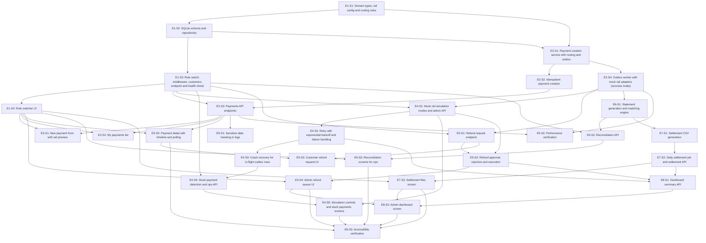

# Dependency Graph

Groups are the longest dependency path from a story with no dependencies. Stories in one group are independent of each other and can run in parallel. No cycles (validated by the generator).

## Group A

| Story | Title | Layer | Depends on |
|---|---|---|---|
| E1-S1 | Domain types, rail config and routing rules | Types | - |

## Group B

| Story | Title | Layer | Depends on |
|---|---|---|---|
| E1-S2 | SQLite schema and repositories | Repository | E1-S1 |

## Group C

| Story | Title | Layer | Depends on |
|---|---|---|---|
| E1-S3 | Role switch middleware, customers endpoint and health check | API | E1-S2 |
| E2-S1 | Payment creation service with routing and outbox | Service | E1-S1, E1-S2 |

## Group D

| Story | Title | Layer | Depends on |
|---|---|---|---|
| E1-S4 | Role switcher UI | UI | E1-S3 |
| E2-S2 | Idempotent payment creation | Service | E2-S1 |
| E2-S4 | Outbox worker with mock rail adapters (success mode) | Service | E2-S1 |

## Group E

| Story | Title | Layer | Depends on |
|---|---|---|---|
| E2-S3 | Payments API endpoints | API | E2-S2, E1-S3 |
| E4-S1 | Mock rail simulation modes and admin API | API | E2-S4, E1-S3 |
| E5-S1 | Refund request endpoint | API | E2-S4, E1-S3 |
| E6-S1 | Statement generation and matching engine | Service | E2-S4 |

## Group F

| Story | Title | Layer | Depends on |
|---|---|---|---|
| E3-S1 | New payment form with rail preview | UI | E2-S3, E1-S4 |
| E3-S2 | My payments list | UI | E2-S3, E1-S4 |
| E3-S3 | Payment detail with timeline and polling | UI | E2-S3, E1-S4 |
| E4-S2 | Retry with exponential backoff and failure handling | Service | E4-S1 |
| E5-S2 | Refund approval, rejection and execution | API | E5-S1, E4-S1 |
| E6-S2 | Reconciliation API | API | E6-S1, E1-S3 |
| E7-S1 | Settlement CSV generation | Service | E6-S1 |
| E9-S1 | Sensitive data masking in logs | Config | E2-S3 |
| E9-S2 | Performance verification | Service | E2-S4, E2-S3 |

## Group G

| Story | Title | Layer | Depends on |
|---|---|---|---|
| E4-S3 | Crash recovery for in-flight outbox rows | Service | E4-S2 |
| E5-S3 | Customer refund request UI | UI | E5-S1, E3-S3 |
| E5-S4 | Admin refund queue UI | UI | E5-S2, E1-S4 |
| E6-S3 | Reconciliation screens for ops | UI | E6-S2, E1-S4 |
| E7-S2 | Daily settlement job and settlement API | API | E7-S1 |

## Group H

| Story | Title | Layer | Depends on |
|---|---|---|---|
| E4-S4 | Stuck payment detection and ops API | API | E4-S3, E1-S3 |
| E7-S3 | Settlement files screen | UI | E7-S2, E1-S4 |
| E8-S1 | Dashboard summary API | API | E5-S2, E7-S2, E4-S2 |

## Group I

| Story | Title | Layer | Depends on |
|---|---|---|---|
| E4-S5 | Simulation controls and stuck payments screens | UI | E4-S1, E4-S4 |
| E8-S2 | Admin dashboard screen | UI | E8-S1, E5-S4, E7-S3 |

## Group J

| Story | Title | Layer | Depends on |
|---|---|---|---|
| E9-S3 | Accessibility verification | UI | E8-S2, E7-S3, E6-S3, E5-S4, E4-S5, E3-S3 |

## Diagram

